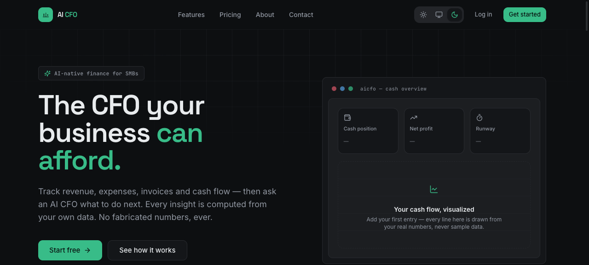
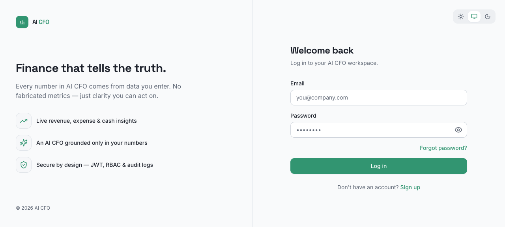

# AI CFO

**Your AI-powered Chief Financial Officer for Small & Medium Businesses.**

[](https://github.com/ashutoshsharma1309/financeproj1/actions/workflows/ci.yml)


A finance SaaS for managing revenue, expenses, invoices, cash flow and
forecasts — with an AI assistant that analyzes **only your own data**. No fake
analytics, no hardcoded metrics, no placeholder business data. Every figure is
computed from what you enter; empty modules show elegant empty states.



---

## ✨ Highlights

- **Real data only** — all totals, charts, forecasts and AI answers are derived
  from user-entered data. If there's no data, you get a beautiful empty state.
- **Soft UI / Claymorphism** design with full **Light / Dark / System** theming
  and persistence.
- **Complete finance suite** — Transactions, Revenue, Expenses, Invoices (with
  line items, tax & PDF export), Cash Flow & runway, Forecasting, Reports
  (P&L / breakdowns, PDF + CSV export).
- **AI CFO assistant** — grounded strictly in your numbers. Works offline with a
  deterministic analyzer; plug in a Gemini key for full generative answers.
- **Auth & RBAC** — signup/login/forgot-password flows with Owner / Accountant /
  Employee roles gating navigation and actions.
- **Audit logs, notifications, team management** and a full marketing site.
- Fully **responsive**, **accessible**, animated, and **type-safe**.

## 🎯 Project scope & status

This is a **front-end-focused application** that runs entirely on the client, so
it's fully functional with zero setup — every calculation, CRUD action and AI
answer works against browser-persisted state. The boundaries are deliberate and
documented, not gaps:

| Area | Status |
| ---- | ------ |
| Finance UI, calculation engine, charts, forecasts, reports, exports | ✅ Real & unit-tested |
| Notifications derived + persisted from real data | ✅ Real |
| AI assistant (offline analyzer; live Gemini when a key is set) | ✅ Real |
| Auth & RBAC | ⚠️ **Client-side stand-in** — a non-crypto hash in a local store; models the flow, not real security |
| Persistence | ⚠️ **`localStorage`** (per-browser); the Prisma schema is the intended production shape |
| Billing, transactional email (invites / password reset), contact form | 🔵 UI only — not wired to a provider |

The Prisma schema, RBAC matrix, and AI route are structured so a real database
and API can be added without UI changes. See
[`docs/adr/`](./docs/adr/README.md) for the reasoning behind these choices and
[`docs/roadmap.md`](./docs/roadmap.md) for what's next.

## 📸 Screenshots

> Everything the app shows is computed from data you enter — nothing is
> hardcoded. Run it locally or open the live demo to explore the dashboard,
> cash flow, reports and AI assistant.

| Landing | Sign in |
| --- | --- |
|  |  |

## 🧱 Tech Stack

| Concern     | Choice                                       |
| ----------- | -------------------------------------------- |
| Framework   | Next.js 14 (App Router) + TypeScript         |
| Styling     | Tailwind CSS + custom design tokens          |
| State       | Zustand (+ persist → localStorage)           |
| Charts      | Recharts (theme-aware)                       |
| Animation   | Framer Motion + CSS                          |
| Validation  | Zod                                          |
| Icons       | lucide-react                                 |
| AI          | Google Gemini (REST) with offline fallback   |
| DB schema   | Prisma (models only — connection left empty) |

## 🚀 Getting Started

```bash
npm install
cp .env.example .env      # fill values when ready (all optional for local use)
npm run dev               # http://localhost:3000
```

Build & run production:

```bash
npm run build && npm run start
```

> The app is fully functional out of the box. Data is persisted in the browser
> so every calculation and CRUD action works without a backend. The Prisma
> schema, Gemini client, auth store and security matrix are structured so a real
> database and API can be added without architectural changes.

## ☁️ Deploy

[](https://vercel.com/new/clone?repository-url=https://github.com/ashutoshsharma1309/financeproj1)

The app deploys to any Node host. On **Vercel**, import the repo — the included
[`vercel.json`](./vercel.json) sets the framework, build command and security
headers. **No environment variables are required** to deploy; add
`GEMINI_API_KEY` only if you want live AI answers.

```bash
npm i -g vercel
vercel        # preview
vercel --prod # production
```

Node version is pinned in [`.nvmrc`](./.nvmrc). CI (lint, typecheck, build)
runs on every push via [GitHub Actions](./.github/workflows/ci.yml) and is
designed to pass with empty secrets — the app degrades gracefully.

## 🔐 Environment Variables

**None are required to run the app.** Only these are read by the current
codebase:

| Variable | Used by | Effect |
| -------- | ------- | ------ |
| `GEMINI_API_KEY` | AI route | Enables live Gemini answers; without it, the offline analyzer is used |
| `GEMINI_MODEL` | AI route | Model name (default `gemini-1.5-flash`) |
| `NEXT_PUBLIC_APP_URL` | SEO metadata | Canonical/OG base URL when deployed |

Without `GEMINI_API_KEY`, the assistant answers using a deterministic analyzer
that reasons over the same financial context — so it never fabricates figures.

The remaining keys in `.env.example` (`DATABASE_URL`, `JWT_SECRET`,
`NEXTAUTH_*`, `SMTP_*`) are **scaffolding for the planned backend** ([roadmap
M5](./docs/roadmap.md)) and are not read by the app today.

## 📁 Structure

```
prisma/schema.prisma          Data models (Users, Companies, Transactions, …)
src/app/(marketing)           Landing, features, pricing, about, contact
src/app/(auth)                Login, signup, forgot password
src/app/(app)                 Authenticated app (dashboard + all modules)
src/app/api/ai/chat           AI endpoint (Gemini + offline fallback, rate-limited)
src/components/ui             Design-system primitives
src/components/charts         Theme-aware chart wrappers
src/components/dashboard      Sidebar, topbar, onboarding, shell
src/lib/store.ts              Global finance store (CRUD + audit logging)
src/lib/calculations.ts       Pure calculation engine (all derived metrics)
src/lib/ai/                   Financial context builder, prompts, Gemini client
src/lib/security.ts           RBAC permission matrix
src/lib/validators.ts         Zod schemas for every form
```

## 🏗️ Architecture at a glance

```
┌─────────────────────────────────────────────────────────────┐
│  App Router (src/app)                                        │
│  (marketing)      (auth)          (app) — authenticated      │
│  landing/pricing  login/signup    dashboard + 15 modules     │
└───────────────┬─────────────────────────┬───────────────────┘
                │ reads/writes             │ derives
        ┌───────▼────────┐        ┌────────▼─────────┐
        │  Zustand stores │        │ calculations.ts  │
        │  store · auth   │        │ (pure functions) │
        │  → localStorage │        │ totals · runway  │
        └───────┬────────┘        │ forecasts · P&L  │
                │                  └────────┬─────────┘
        ┌───────▼────────┐        ┌────────▼─────────┐
        │ validators (zod)│        │ AI route + Gemini│
        │ security (RBAC) │        │ offline fallback │
        └────────────────┘        └──────────────────┘
```

State lives in the browser today; the Prisma schema and API layer are shaped so
a real database can be dropped in without UI changes. Every number the UI shows
is produced by a pure function in `calculations.ts` — never hardcoded.

## 🧮 How calculations work

`src/lib/calculations.ts` contains pure functions that transform your entries
into every metric shown in the UI — totals, month-over-month deltas, category
breakdowns, cash position, runway, forecasts and P&L. Nothing is hardcoded;
empty inputs return zeroed results and the UI renders empty states.

## 🛡️ Security architecture

**Real today:** input validation & sanitization for every form
(`src/lib/validators.ts`, Zod), an RBAC permission matrix gating UI and actions
(`src/lib/security.ts`), rate limiting on the AI route, security headers
(`vercel.json`), and an audit trail for every create/update/delete.

**Deliberate stand-in:** authentication (`src/lib/auth.ts`) is a client-side
store using a **non-cryptographic** hash — it models the signup/login/RBAC flow
for the demo but is **not** real security. The store mirrors a real backend's
shape, and the same RBAC matrix is designed to gate server routes, so the
production path is: Prisma + Postgres, password hashing (argon2/bcrypt),
JWT/session cookies, and server-side permission checks — added without UI
changes. See [ADR 0011](./docs/adr/0011-client-auth-rbac.md).
