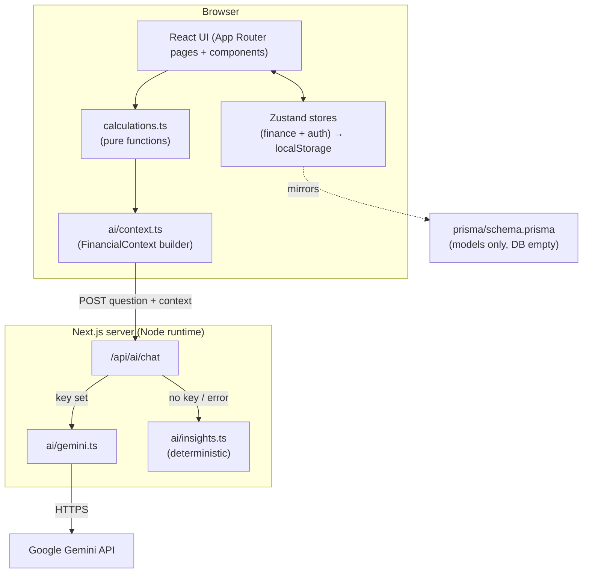
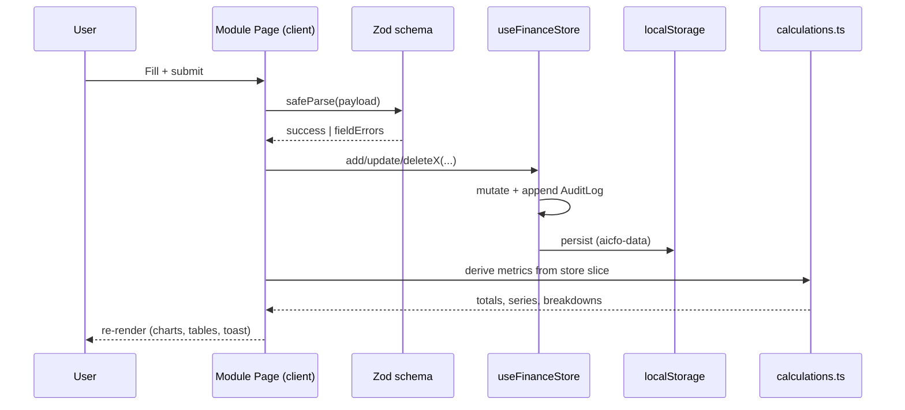
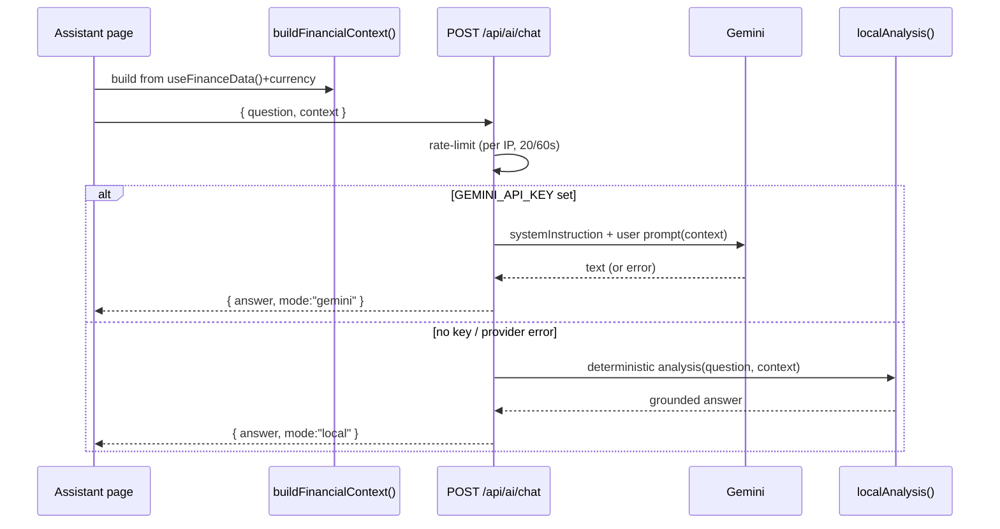
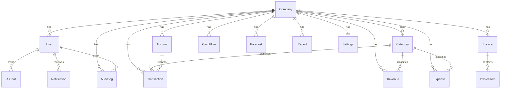
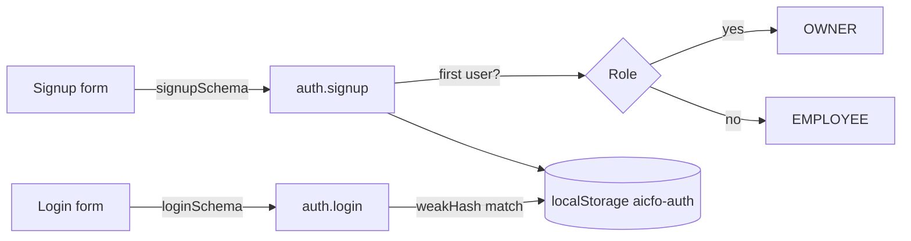

# AI CFO — Project Knowledge Document

> A single, self-contained reference for the AI CFO codebase. It is written so
> that an AI assistant can use it as primary context for future development
> **without reading the source first**. Where a statement is inferred rather than
> directly evidenced by code, it is marked _(inferred)_.

---

## Table of Contents

1. [Project Summary](#project-summary)
2. [Features](#features)
3. [Architecture](#architecture)
4. [Tech Stack](#tech-stack)
5. [Application Flow](#application-flow)
6. [Components / Modules](#components--modules)
7. [API Documentation](#api-documentation)
8. [Database](#database)
9. [Authentication & Authorization](#authentication--authorization)
10. [Configuration](#configuration)
11. [Dependencies](#dependencies)
12. [External Integrations](#external-integrations)
13. [Important Algorithms](#important-algorithms)
14. [Coding Patterns](#coding-patterns)
15. [Build & Run Instructions](#build--run-instructions)
16. [Testing](#testing)
17. [Current Limitations](#current-limitations)
18. [Improvement Opportunities](#improvement-opportunities)
19. [AI Development Context](#ai-development-context)
20. [Glossary](#glossary)

---

## Project Summary

- **Project name:** AI CFO
- **Tagline:** "Your AI-powered Chief Financial Officer for Small & Medium Businesses."
- **Purpose:** Give small and medium businesses (SMBs) a single, premium place to
  record their finances (revenue, expenses, transactions, invoices, accounts) and
  to receive dashboards, cash-flow/runway analysis, forecasts, reports, and an AI
  assistant — all computed **exclusively from user-entered data**.
- **Problem it solves:** SMBs typically run on spreadsheets and gut feel; real CFO
  expertise (cash discipline, forecasting, risk detection) is locked away in
  enterprises. AI CFO delivers that in a trustworthy tool that never fabricates
  numbers. When there is no data, the UI shows an empty state instead of fake
  analytics.
- **High-level overview:** A Next.js 14 (App Router) + TypeScript single-app
  frontend. It is **fully functional against browser-persisted state today**
  (Zustand + `localStorage`); the database schema (Prisma, models only) and API
  layer are shaped so a real backend can be added later **without UI changes**.
  The AI assistant calls a server route that uses Google Gemini when a key is
  present, and otherwise a deterministic, data-grounded analyzer.

### Core promise (a hard project constraint)

Every figure shown anywhere in the product must be **derived from data the user
entered**. There is no seeded/fake business data. The only seeded values are
category **labels** (e.g. "Payroll", "Sales") created on company setup — these
are classification labels, not financial figures.

---

## Features

### Implemented

**Marketing site** (`(marketing)` route group)
- Landing page with animated hero ("financial pulse" SVG that draws itself),
  capability marquee, features, how-it-works, spreadsheet-vs-AI-CFO comparison,
  audiences, trust strip, FAQ, CTA, JSON-LD structured data, back-to-top button.
- Features, Pricing, About, Contact (validated contact form — front-end only).

**Auth** (`(auth)` route group)
- Signup (with live password-strength meter), Login (show/hide password),
  Forgot Password (SMTP-ready structure; simulated send).
- First account created becomes **Owner**; subsequent accounts default to
  **Employee**.

**Authenticated app** (`(app)` route group), gated by auth + onboarding:
- **Onboarding** — company setup (name, industry, currency, fiscal-year start,
  optional tax id). Seeds default income/expense **category labels**.
- **Dashboard** — KPI cards (revenue, expenses, net profit, outstanding) with
  month-over-month deltas, income-vs-expense area chart, expense-breakdown donut,
  recent activity, invoice-health, AI shortcut.
- **Transactions** — unified income/expense ledger with type tabs, text search,
  CRUD, CSV export.
- **Revenue** / **Expenses** — dedicated CRUD modules with summary cards and CSV
  export.
- **Invoices** — line-item invoices with tax, live subtotal/tax/total preview,
  statuses, a view dialog, and per-invoice **PDF export**.
- **Cash Flow** — accounts CRUD (cash/bank/credit/asset/liability), cash position,
  monthly net, runway, net worth, balance-trend line chart, inflow-vs-outflow bar
  chart.
- **Forecasts** — scenario CRUD (horizon, starting cash, revenue/expense growth);
  projected revenue/expense/cash chart; multi-scenario compare.
- **Reports** — Profit & Loss and category Breakdown views with period selector
  (all/month/quarter/year); **CSV and PDF export**.
- **AI Assistant** — chat UI with suggested prompts; posts a factual context to
  `/api/ai/chat`; renders lightweight markdown; chat history persisted.
- **Company Settings** — edit company profile, manage categories (add/delete),
  preferences (email notifications, low-cash alert + threshold), **Reset
  workspace** (danger zone).
- **Profile** — edit display name; view account info and role.
- **Team Members** — invite members with a role; change role; remove; the signed-in
  Owner is shown as the anchor member.
- **Audit Logs** — read-only trail of create/update/delete actions, filter tabs,
  search, CSV export. (Entries are generated by the store on every mutation.)
- **Notifications** — alerts (overdue invoices, runway < 6 months) are **derived
  from real data and persisted** with condition-key de-duplication, so the topbar
  bell is accurate on every page and never duplicates on re-visit. Logic lives in
  the pure `deriveAlerts`/`pickNewAlerts` helper (`src/lib/notifications.ts`) with
  a `<NotificationSync />` shell component driving `ingestAlerts`.
- **Billing** — placeholder (plan display + upgrade CTA; no payment provider).
- **Help Center** — searchable topics and FAQ.

**Cross-cutting**
- Light / Dark / System theming with persistence (`next-themes`).
- Responsive layout; keyboard `/` focuses app search; skip-to-content link;
  `aria-current` on active nav; reduced-motion respected.
- Error boundary (`error.tsx`), loading skeletons (`loading.tsx`), 404 page.
- SEO: `robots.txt`, `sitemap.xml`, `manifest.webmanifest`, favicon (`icon.svg`),
  Open Graph/Twitter metadata, JSON-LD.

### Incomplete / partially implemented

- **Persistence is browser-only.** Data lives in `localStorage`; there is no live
  database or server persistence yet. Clearing site data / switching browser wipes
  the workspace.
- **Authentication is a client-side stand-in.** No real JWT verification, no
  server sessions, no email verification/reset delivery. Passwords are stored in
  the browser using a **non-cryptographic** hash (demo only).
- **Billing** is a placeholder (no Stripe or any provider).
- **Forgot-password** and **team invites** describe SMTP but do not send email.
- **`Report` / `CashFlow` Prisma models** exist but are **not currently exercised
  by the UI** _(inferred: no callers found)_ — they are future-ready. (The store's
  old `pushNotification` action was removed once the de-duplicating `ingestAlerts`
  superseded it.)
- **Contact form** validates and shows a success toast but does not deliver a
  message.

### Future-ready components already present

- Prisma schema (all models) with `DATABASE_URL` wired but empty.
- Gemini client + prompt scaffolding (key read from env; graceful fallback).
- RBAC permission matrix intended to gate server routes too.
- Auth store shaped like a real API client (swap three methods for `fetch`).
- Rate-limiter on the AI route (in-memory; ready to back with Redis).

---

## Architecture

### Overall

A **client-heavy Next.js App Router** application. Marketing and auth pages are
statically prerendered; the authenticated app is composed of client components
that read/write a persisted Zustand store and derive every metric through pure
functions. The only server code is the AI route handler.



### Design patterns used

- **Route groups** to separate concerns: `(marketing)`, `(auth)`, `(app)`.
- **Store + selector** pattern (Zustand). Selectors must return **stable
  references** (see pitfalls) — derived data is computed with `useMemo` or
  `useShallow`.
- **Pure functional core** — all financial math is in side-effect-free functions
  (`calculations.ts`), which makes them trivially testable.
- **Adapter/stand-in** — `auth.ts` mimics a real backend's response shape so the
  UI is backend-agnostic.
- **Strategy/fallback** — AI route picks Gemini or the local analyzer.
- **Compound components** — UI primitives (`Card`, `Field`, `Dialog`, `Dropdown`).
- **Schema-first validation** — every form validated by a Zod schema; errors
  flattened to a `{ field: message }` map.
- **Audit interception** — every store mutation appends an audit log entry.

### Folder structure

```
financeproj/
├─ prisma/schema.prisma        # Data models only (no DB connection)
├─ public/                     # humans.txt, .well-known/security.txt
├─ docs/                       # Extensive guides (architecture, modules, etc.)
├─ src/
│  ├─ app/                     # Next.js App Router
│  │  ├─ layout.tsx            # Root layout: fonts, theme, toaster, metadata
│  │  ├─ globals.css           # Design tokens (CSS vars), textures, animations
│  │  ├─ fonts.ts              # next/font: Space Grotesk, Inter, JetBrains Mono
│  │  ├─ error.tsx / not-found.tsx
│  │  ├─ robots.ts / sitemap.ts / manifest.ts / icon.svg
│  │  ├─ (marketing)/          # Public site + layout (nav/footer/back-to-top)
│  │  ├─ (auth)/               # login / signup / forgot-password + split layout
│  │  ├─ (app)/                # Authenticated app + DashboardShell layout
│  │  │  ├─ layout.tsx         # Wraps children in <DashboardShell>
│  │  │  ├─ loading.tsx        # Skeleton
│  │  │  └─ <module>/page.tsx  # dashboard, transactions, revenue, ...
│  │  └─ api/ai/chat/route.ts  # The only server endpoint
│  ├─ components/
│  │  ├─ ui/                   # Design-system primitives
│  │  ├─ charts/               # Theme-aware Recharts wrappers
│  │  ├─ dashboard/            # Shell, sidebar, topbar, onboarding, nav-config
│  │  ├─ marketing/            # Nav, footer, hero visual, marquee, comparison
│  │  ├─ assistant/            # message-content (safe markdown renderer)
│  │  ├─ theme/                # ThemeProvider + toggle
│  │  ├─ motion/               # Scroll-reveal helpers (framer-motion)
│  │  └─ brand/                # Logo
│  ├─ hooks/                   # use-hydrated, use-finance-data
│  └─ lib/
│     ├─ store.ts              # Finance store (CRUD + audit logging)
│     ├─ auth.ts               # Auth store (client stand-in)
│     ├─ types.ts              # Domain types (mirror of Prisma models)
│     ├─ calculations.ts       # Pure calculation engine (+ .test.ts files)
│     ├─ validators.ts         # Zod schemas + fieldErrors
│     ├─ security.ts           # RBAC permission matrix + can()
│     ├─ constants.ts          # Currencies, industries, account kinds, colors
│     ├─ export.ts             # CSV + print-to-PDF
│     ├─ utils.ts              # cn, formatting, uid, sumBy, etc.
│     └─ ai/                   # context, prompts, gemini, insights
├─ .github/                    # CI (ci, codeql, labeler, stale), templates, etc.
├─ next.config.mjs             # Security headers, package-import optimization
├─ vercel.json                 # Framework + headers for Vercel
├─ vitest.config.ts            # Test config (@ alias, node env)
└─ tailwind.config.ts          # Tokens → Tailwind theme
```

### Important files and why they exist

| File | Why it exists |
| --- | --- |
| `src/lib/store.ts` | Single source of truth for all business data + CRUD + audit logging |
| `src/lib/calculations.ts` | Every derived metric; the analytical heart of the app |
| `src/lib/auth.ts` | Client-side auth stand-in mirroring a real API |
| `src/lib/security.ts` | RBAC matrix; gates nav and (future) API |
| `src/lib/validators.ts` | Zod schemas for all forms |
| `src/lib/ai/*` | Context builder, prompts, Gemini client, offline analyzer |
| `src/app/api/ai/chat/route.ts` | The only server endpoint (AI) |
| `src/components/dashboard/dashboard-shell.tsx` | Hydration + auth + onboarding gate for the app |
| `src/components/dashboard/nav-config.ts` | Sidebar nav + per-item permission mapping |
| `src/app/globals.css` + `tailwind.config.ts` | Design tokens for both themes |
| `prisma/schema.prisma` | Target data model for future persistence |

---

## Tech Stack

- **Language:** TypeScript (strict), TSX/JSX, CSS.
- **Framework:** Next.js `14.2.18` (App Router, React `18.3`).
- **State:** Zustand `^5` with `persist` middleware (localStorage).
- **Validation:** Zod `^3`.
- **Charts:** Recharts `^2`.
- **Animation:** Framer Motion `^11` + CSS keyframes.
- **Icons:** lucide-react.
- **Styling:** Tailwind CSS `^3.4` with CSS-variable design tokens; `clsx` +
  `tailwind-merge` (`cn`).
- **Fonts:** `next/font/google` — Space Grotesk (display), Inter (body),
  JetBrains Mono (numerals).
- **Theming:** next-themes.
- **AI:** Google Gemini via REST (`v1beta .../:generateContent`) — no SDK.
- **ORM / schema:** Prisma `^5` (`@prisma/client`), Postgres provider (connection
  empty).
- **Build tool:** Next.js / SWC. **Package manager:** npm (`package-lock.json`).
- **Tests:** Vitest `^2`.
- **Lint/format:** ESLint (`next/core-web-vitals`), Prettier config, EditorConfig,
  markdownlint, commitlint config.
- **Infra/CI:** GitHub Actions (CI, CodeQL, labeler, stale), Dependabot.
- **Deployment target:** Vercel (`vercel.json`) or any Node 20+ host; `.nvmrc` → 22.

---

## Application Flow

### Entry point & initialization

1. `src/app/layout.tsx` (root) applies font CSS variables, wraps the tree in
   `ThemeProvider` (next-themes, `storageKey="aicfo-theme"`, default `system`) and
   `ToastProvider`, and sets global metadata. The `<body>` carries the `grain`
   texture class.
2. Each route group has its own layout:
   - `(marketing)/layout.tsx` → nav + footer + back-to-top + skip link.
   - `(auth)/layout.tsx` → split brand/form screen.
   - `(app)/layout.tsx` → renders `<DashboardShell>`.

### App gating (auth + onboarding)

`DashboardShell` (client) enforces access:

```mermaid
flowchart TD
  A[Enter any /(app) route] --> B{hydrated?}
  B -- no --> S[Show spinner]
  B -- yes --> C{user present?}
  C -- no --> L[router.replace /login]
  C -- yes --> D{onboarded?}
  D -- no --> O[Render Onboarding company setup]
  D -- yes --> M[Render Sidebar + Topbar + page]
```

`useHydrated()` ensures the persisted store has rehydrated before rendering to
avoid hydration mismatches.

### Authentication flow

- **Signup:** `signupSchema` → `useAuthStore.signup()` creates a `StoredUser`
  (role OWNER if first, else EMPLOYEE), sets `user` + a fake `token`, persists to
  `aicfo-auth`. Redirect to `/dashboard`.
- **Login:** compares `weakHash(password)` against the local registry.
- **Logout:** clears `user`/`token`; the shell then redirects to `/login`.
- No server round-trip today; see [Authentication & Authorization](#authentication--authorization).

### Request / data flow (CRUD)



### AI request flow



### Business logic, DB, external APIs, jobs, caching, error handling

- **Business logic:** entirely in `calculations.ts` (pure) and store actions.
- **Database interactions:** none at runtime (Prisma schema is models-only). All
  reads/writes go to the Zustand store → `localStorage`.
- **External APIs:** only Google Gemini, and only from the server route when
  `GEMINI_API_KEY` is set.
- **Background jobs:** none. **Caching:** Next.js static generation for
  public pages; Gemini fetch is `cache: "no-store"`; the AI route uses an
  in-memory per-IP rate limit map (ephemeral).
- **Error handling:** form-level via Zod + inline field errors + toasts; the AI
  route returns typed JSON errors (400/429) and falls back to local analysis on
  provider failure; app-level via `error.tsx` boundary and `not-found.tsx`.

### Shutdown

There is no long-running server process beyond Next.js; "shutdown" simply means
stopping the Next server. Client state persists in `localStorage` across sessions.

---

## Components / Modules

### `lib/store.ts` — Finance store
- **Purpose:** hold all business data and mutate it.
- **State:** `onboarded`, `company`, `categories`, `accounts`, `transactions`,
  `revenues`, `expenses`, `invoices`, `forecasts`, `chats`, `notifications`,
  `team`, `auditLogs`, `settings`.
- **Responsibilities:** CRUD for every entity; append an `AuditLog` on each
  mutation (`logAction`, capped at 500); seed default categories on first
  `setCompany`; assign ids via `uid()`; persist under `aicfo-data`.
- **Public interface:** `setCompany`, `add/update/delete*` per entity,
  `createChat/addMessage/deleteChat`, notification + team + settings actions,
  `resetAll`.
- **Dependencies:** `zustand`, `./utils` (`uid`), `./types`.

### `lib/auth.ts` — Auth store
- **Purpose:** client-side auth stand-in.
- **Interface:** `signup`, `login`, `logout`, `requestPasswordReset`,
  `updateProfile`; state `user`, `token`, `users`.
- **Notes:** `weakHash` is **non-cryptographic** (demo). First user → OWNER.

### `lib/calculations.ts` — Calculation engine
- **Purpose:** derive every metric from `FinanceData`.
- **Public functions:** `invoiceSubtotal/Tax/Total`, `incomeStream`,
  `expenseStream`, `totalRevenue`, `totalExpenses`, `netProfit`, `profitMargin`,
  `cashPosition`, `totalAssets`, `totalLiabilities`, `monthlySeries`,
  `monthOverMonth`, `categoryBreakdown`, `invoiceStats`,
  `effectiveInvoiceStatus`, `cashFlowSeries`, `monthlyBurn`, `runwayMonths`,
  `projectForecast`, `buildProfitLoss`, `hasAnyData`.
- **Dependencies:** `./utils`, `./types` only. No side effects.

### `lib/ai/*`
- `context.ts` → `buildFinancialContext(data, currency)` produces the only object
  the AI may reason over.
- `prompts.ts` → `SYSTEM_PROMPT` (strict "no fabrication" rules),
  `SUGGESTED_PROMPTS`, `buildUserPrompt`.
- `gemini.ts` → `isGeminiConfigured()`, `generateWithGemini()` (server-only REST).
- `insights.ts` → `localAnalysis(question, context)` deterministic answers keyed
  by intent (runway, what-if, hiring, expenses, revenue, invoices, risks, default
  health summary).

### `components/dashboard/*`
- `dashboard-shell.tsx` — hydration/auth/onboarding gate + layout.
- `sidebar.tsx` — grouped nav filtered by `can(role, permission)`; `aria-current`.
- `topbar.tsx` — page search (`/` shortcut), notifications badge, theme toggle,
  user menu (logout).
- `onboarding.tsx` — company setup form.
- `nav-config.ts` — nav groups + per-item permission.

### `components/ui/*` (design-system primitives)
`Button`, `Card`, `Input/Textarea/Select/Label/Field`, `Badge`, `Dialog`,
`ConfirmDialog`, `Dropdown`, `EmptyState`, `Skeleton`, `StatCard`, `PageHeader`,
`Tabs/Switch/Progress` (`misc.tsx`), `SkipLink`, `toast` (provider + `useToast`).

### `components/charts/index.tsx`
Theme-aware Recharts wrappers reading CSS variables: `TrendAreaChart`,
`CompareBarChart`, `CashLineChart`, `ForecastChart`, `BreakdownDonut`, plus a
custom tooltip. Numeric axes format via `formatCompact`.

### Hooks
- `use-hydrated.ts` — returns true after mount (persist rehydration guard).
- `use-finance-data.ts` — `useFinanceData()` returns the `FinanceData` slice via
  `useShallow` (stable reference), and `useCurrency()`.

---

## API Documentation

There is exactly **one** HTTP endpoint.

### `POST /api/ai/chat`
- **Runtime:** Node (`export const runtime = "nodejs"`).
- **Auth:** none currently (client-only app). _(inferred: intended to sit behind
  auth once a backend exists.)_
- **Rate limit:** in-memory per client IP (from `x-forwarded-for`), **20 requests
  / 60s**; exceeding returns `429`.
- **Request body:**
  ```json
  {
    "question": "string (<= 2000 chars)",
    "context": { /* FinancialContext from ai/context.ts */ }
  }
  ```
- **Success response:**
  ```json
  { "answer": "string", "mode": "gemini" | "local", "note": "optional" }
  ```
  `mode` is `gemini` when the key is set and the call succeeds; otherwise `local`.
- **Error responses:**
  - `400` — `{ "error": "Invalid request body." }` or `{ "error": "A question and financial context are required." }`
  - `429` — `{ "error": "Too many requests. Please slow down." }`
- **Behavior:** if `GEMINI_API_KEY` is set, calls Gemini and, on any provider
  error, silently falls back to the local analyzer (still `200`). Without a key it
  always uses the local analyzer.

_No REST/GraphQL endpoints exist for CRUD — all data operations are client-side
store actions._

---

## Database

- **Type:** PostgreSQL via **Prisma** — schema only. `datasource db { provider =
  "postgresql"; url = env("DATABASE_URL") }` with `DATABASE_URL` intentionally
  empty. **No queries run at runtime.**
- **Runtime storage today:** browser `localStorage` keys `aicfo-data` (finance),
  `aicfo-auth` (auth), `aicfo-theme` (theme). The TS types in `src/lib/types.ts`
  mirror the Prisma models.

### Models (Prisma)

`User`, `Company`, `Category`, `Account`, `Transaction`, `Revenue`, `Expense`,
`Invoice`, `InvoiceItem`, `CashFlow`, `Forecast`, `Report`, `AIChat`,
`Notification`, `AuditLog`, `Settings`.

**Enums:** `Role(OWNER, ACCOUNTANT, EMPLOYEE)`,
`TransactionType(INCOME, EXPENSE)`,
`InvoiceStatus(DRAFT, SENT, PAID, OVERDUE, CANCELLED)`,
`CategoryKind(INCOME, EXPENSE)`,
`AccountKind(CASH, BANK, CREDIT, ASSET, LIABILITY)`,
`NotificationType(INFO, SUCCESS, WARNING, DANGER)`,
`ReportType(PROFIT_LOSS, CASH_FLOW, EXPENSE_BREAKDOWN, REVENUE_BREAKDOWN, MONTHLY, QUARTERLY, YEARLY)`.

### Relationships (ER)



- **Important fields:** monetary values use `Decimal(14,2)`; `Company.currency`
  (default `INR`), `Company.fiscalYearStart` (1–12); `Invoice.taxRate`
  `Decimal(5,2)`; `Forecast.assumptions`/`result` and `Report.data`/`AIChat.messages`
  are `Json`.
- **Indexes:** composite indexes on `companyId` (+ `date`/`status`/`type`/`createdAt`)
  across financial tables; `Settings.companyId` and `User.email` are unique.
- **Migrations:** none committed (`prisma/migrations` not present). Run
  `prisma migrate` after providing `DATABASE_URL`.

> **Client vs. Prisma nuance:** the client `Company`/`AuditLog`/`Notification`
> types are simplified mirrors (e.g. client `AuditLog` has `detail`/`actor`
> strings; Prisma `AuditLog` has `action/entity/entityId/metadata`). Reconcile
> these when wiring the DB.

---

## Authentication & Authorization

### Login flow (current)
Client-only. `login()`/`signup()` operate on a local `users` registry in
`aicfo-auth`. Passwords are compared via `weakHash` (a 32-bit rolling hash — **not
secure**, demo only). A random `token` string stands in for a JWT.



### Session / JWT handling
- No real sessions. `token` is a placeholder. Intended production path (documented
  in `auth.ts`): `POST /api/auth/{signup,login,logout}` returning `{ user, token }`,
  with JWT verification server-side.

### Roles & permissions
- **Roles:** `OWNER`, `ACCOUNTANT`, `EMPLOYEE`.
- **Permissions:** `view:dashboard`, `manage:transactions`, `manage:invoices`,
  `manage:company`, `manage:team`, `view:reports`, `view:audit`, `use:ai`.
- **Matrix** (`security.ts`):
  - OWNER → all permissions.
  - ACCOUNTANT → dashboard, transactions, invoices, reports, ai.
  - EMPLOYEE → dashboard, reports.
- **Enforcement:** `can(role, permission)` filters sidebar nav items
  (`nav-config.ts`). It is **UI-level only today**; the same matrix is intended to
  gate server routes once a backend exists.

### Security mechanisms present
- Input validation (Zod) + `sanitize()` on free-text fields (strips `<>`).
- Rate limiting on the AI route.
- HTTP security headers (`next.config.mjs` + `vercel.json`): `X-Content-Type-Options`,
  `X-Frame-Options`, `Referrer-Policy`, `Permissions-Policy`; `poweredByHeader:false`.
- Audit logging of all mutations.
- `security.txt` (RFC 9116) + `SECURITY.md`.

> **Security caveats (do not ship as-is):** client-side password storage,
> non-crypto hashing, no server auth, and a JSON-serialized context sent to the AI
> route. Treat all of this as scaffolding.

---

## Configuration

### Environment variables (`.env.example`; all optional locally)

| Variable | Purpose |
| --- | --- |
| `DATABASE_URL` | Postgres connection for Prisma (unused until wired) |
| `GEMINI_API_KEY` | Enables generative AI answers; absent → local analyzer |
| `GEMINI_MODEL` | Model id (default `gemini-1.5-flash`) |
| `JWT_SECRET`, `NEXTAUTH_SECRET`, `NEXTAUTH_URL` | Future auth |
| `SMTP_HOST/PORT/USER/PASS/FROM` | Future email (verification, reset, invites) |
| `NEXT_PUBLIC_APP_NAME` | Display name |
| `NEXT_PUBLIC_APP_URL` | Public base URL — used for `metadataBase`, sitemap, robots, JSON-LD |

> Only `NEXT_PUBLIC_*` values reach the browser. The only variable that changes
> **runtime behavior today** is `GEMINI_API_KEY` (and `GEMINI_MODEL`).

### Config files
- `next.config.mjs` — security headers, `optimizePackageImports`, image formats.
- `tailwind.config.ts` — maps CSS-variable tokens to Tailwind theme; fonts;
  shadows.
- `globals.css` — the actual token values for light/dark, textures, keyframes.
- `vercel.json`, `.nvmrc` (22), `vitest.config.ts`, `tsconfig.json` (`@/*` → `src/*`),
  `.eslintrc.json`, `.prettierrc`, `.editorconfig`, `.commitlintrc.json`,
  `.markdownlint.json`, `.npmrc`.

### Secrets required for production
`DATABASE_URL`, `JWT_SECRET`, `NEXTAUTH_SECRET`, optionally `GEMINI_API_KEY` and
SMTP credentials. None are needed for a local run.

---

## Dependencies

**Runtime**
- `next`, `react`, `react-dom` — framework/UI.
- `zustand` — state + persistence.
- `zod` — schema validation.
- `recharts` — charts.
- `framer-motion` — animation (hero, reveals, dialogs).
- `lucide-react` — icons.
- `clsx` + `tailwind-merge` — the `cn()` class combiner.
- `next-themes` — theme switching/persistence.
- `@prisma/client` — generated client type surface (schema only for now).
- `date-fns` — **declared but not imported anywhere** _(dead dependency; date
  formatting is done via `Intl` in `utils.ts`)_.

**Dev**
- `typescript`, `@types/*`, `eslint` + `eslint-config-next`, `tailwindcss`,
  `postcss`, `autoprefixer`, `prisma`, `vitest`.

---

## External Integrations

- **Google Gemini** — the only external service, called server-side via REST
  (`generativelanguage.googleapis.com/v1beta/models/{model}:generateContent`),
  gated on `GEMINI_API_KEY`. `temperature 0.4`, `maxOutputTokens 1024`,
  `cache: "no-store"`.
- **Google Fonts** — fetched at **build time** by `next/font` (self-hosted after
  build; no runtime external font requests).
- No payment gateway, messaging system, analytics, or cloud SDKs are integrated.
  Vercel is the suggested host (config present) but not required.

---

## Important Algorithms

- **Unified income/expense streams:** income = revenue entries + `INCOME`
  transactions + **PAID** invoices; expenses = expense entries + `EXPENSE`
  transactions. All totals derive from these.
- **Cash position:** `(CASH + BANK balances) − (CREDIT + LIABILITY balances)`.
- **Monthly series:** seeds a trailing N-month window (so charts always span a
  full range), then buckets stream items by `YYYY-MM`.
- **Runway:** `monthlyBurn` = average `net` over trailing months with activity;
  `runwayMonths` = `cash / |burn|` when burn is negative, else `Infinity`.
- **Forecast projection:** baseline = average income/expense over trailing 6 active
  months; each month `m`, `revenue = base × (1 + g_rev/100)^m` and likewise for
  expense (compound growth); cash accumulates net.
- **Effective invoice status:** a `SENT` invoice past its due date is treated as
  `OVERDUE` (`effectiveInvoiceStatus`). `invoiceStats` also buckets by this
  **effective** status, so the overdue figures in the KPI cards, the AI context,
  and the notifications alert all match the status badge shown in the invoices
  table. `outstanding` still includes overdue (the money is owed).
- **Local AI analysis:** intent routing by keyword over a lowercased question →
  templated, number-grounded answers; a regex `(\d{1,3})\s*%` extracts the
  percentage for "what-if" scenarios.
- **PDF export:** opens a new window, writes an inline-styled HTML report, and
  calls `window.print()` so the user saves as PDF.
- **CSV export:** RFC-4180-style escaping of cells containing `" , \n`.

---

## Coding Patterns

- **Naming:** files kebab-case; React components PascalCase; hooks `useX`; pure
  helpers camelCase; store actions verb-first (`addRevenue`, `updateInvoice`).
- **State management:** Zustand stores with `persist`; read via selectors. Derived
  arrays/objects computed with `useMemo` or `useShallow` — **never** returned
  directly from a selector (see pitfalls).
- **Validation:** every form uses a Zod schema + `fieldErrors()` → inline messages.
- **Error handling:** `safeParse` for forms; typed JSON errors + fallback in the
  AI route; `error.tsx` boundary; `useToast` for user feedback.
- **Logging:** no logger library; `console.error` in the error boundary; audit
  logs are a domain feature, not diagnostics.
- **Dependency injection:** none formal; modules import concrete implementations.
- **Styling:** Tailwind utility classes + `cn()`; numeric values use the `.tnum`
  monospace class; tokens are CSS variables so themes swap instantly.
- **Client/server boundary:** pages that use hooks/stores are `"use client"`;
  Gemini client and the route are server-only.

---

## Build & Run Instructions

```bash
# Install (Node 20+, repo pins 22 via .nvmrc)
npm install

# Configure (optional locally — everything works empty)
cp .env.example .env

# Develop
npm run dev            # http://localhost:3000

# Quality gates
npm run lint
npm run typecheck
npm test               # Vitest (40 tests)

# Production
npm run build
npm run start          # serves on $PORT (default 3000)
```

- **Deployment (Vercel):** import the repo; `vercel.json` provides framework +
  headers; set env vars in project settings; deploy. Self-host: `npm ci && npm run
  build && npm run start` behind a TLS proxy.
- **Note:** the first build fetches Google Fonts; ensure network access. The build
  is designed to pass with **all secrets empty**.
- **Port gotcha (environment-specific):** if 3000 is taken, run
  `PORT=<free-port> npm run start`.

---

## Testing

- **Framework:** Vitest (`node` environment, `@ → src` alias in `vitest.config.ts`).
- **Location:** `src/lib/*.test.ts` (co-located).
- **Suite (7 files, 40 tests):** `calculations.test.ts` (invoice math,
  revenue/expense/profit, cash position, invoice stats, empty guard),
  `utils.test.ts` (formatting, `pctChange`, `sumBy`, `clamp`, `monthKey`),
  `security.test.ts` (RBAC matrix), `breakdown.test.ts`, `profit-loss.test.ts`,
  `invoice-status.test.ts`, `forecast.test.ts`.
- **Coverage focus:** the pure calculation engine and helpers. **No** component,
  integration, or e2e tests exist yet.
- **Run:** `npm test` (CI runs it on every push/PR via `.github/workflows/ci.yml`).

---

## Current Limitations

- **No real persistence** — browser `localStorage` only; not multi-device, easily
  wiped.
- **No real auth/security** — client-side registry, non-crypto password hash, no
  JWT/session, no email delivery.
- **Billing** is a non-functional placeholder.
- **`pushNotification`, `CashFlow`/`Report` models** unused by UI (future-ready).
- **`date-fns`** is an unused dependency.
- **AI route is unauthenticated** and rate-limited only in-memory (per-instance).
- **No component/e2e tests**; no observability/error tracker wired.
- **No `TODO/FIXME`markers** in source (clean), but the above are the real gaps.

---

## Improvement Opportunities

- Wire Prisma + a real backend: replace the three `auth.ts` methods and store
  actions with API calls; the UI is already decoupled.
- Real auth: JWT/session, argon2/bcrypt hashing, email verification & reset via
  SMTP; enforce `can()` server-side.
- Add a **user-triggered** sample-data loader for demos (clearly labeled) without
  violating the "no fabricated data" rule.
- Persist notifications via `pushNotification` (e.g. on overdue/low-cash) instead
  of computing them only on the Notifications page.
- Remove `date-fns` or adopt it; add component/e2e tests (Playwright) and coverage
  reporting; add an error tracker (Sentry).
- Back the AI rate-limiter with Redis; add auth to the route.

---

## AI Development Context

**How to add a new feature (recommended workflow):**
1. **Type it** — add/extend interfaces in `src/lib/types.ts` (and mirror in
   `prisma/schema.prisma` if it's a persisted entity).
2. **Store it** — add state + `add/update/delete` actions in `src/lib/store.ts`;
   append an `AuditLog` via `logAction` inside each mutation; assign ids with
   `uid("prefix")`.
3. **Validate it** — add a Zod schema in `src/lib/validators.ts`.
4. **Compute it** — put any derived metric as a **pure function** in
   `src/lib/calculations.ts` and add a `*.test.ts`.
5. **Show it** — create `src/app/(app)/<module>/page.tsx` (a `"use client"`
   component), reuse `PageHeader`, `Card`, `StatCard`, `EmptyState`, `Dialog`,
   `ConfirmDialog`, `Dropdown`, and the chart wrappers. Render an **empty state**
   when there's no data.
6. **Route it** — add a nav entry (with a `permission`) in
   `src/components/dashboard/nav-config.ts`.
7. **Verify** — `npm run typecheck && npm test && npm run build`.

**Conventions to follow:**
- Never hardcode or fabricate business figures; derive everything from the store.
- Keep numbers in the `.tnum` class; use `formatCurrency`/`formatCompact`.
- Client components for anything using hooks/stores; keep server-only code in
  `route.ts`/`gemini.ts`.
- Use existing UI primitives and Tailwind tokens; don't introduce bespoke colors —
  add a CSS variable in `globals.css` if needed.

**Files to modify for common tasks:**
- New entity/CRUD → `types.ts`, `store.ts`, `validators.ts`, new page, `nav-config.ts`.
- New metric/chart → `calculations.ts` (+ test), `components/charts/index.tsx`.
- New AI capability → `ai/insights.ts` (intent branch) and/or `ai/prompts.ts`;
  extend `ai/context.ts` if new data is needed.
- Theme/design change → `globals.css` (tokens) then `tailwind.config.ts`.
- Permissions → `security.ts` (matrix) + `nav-config.ts`.

**Do not change lightly:**
- The **selector stability rule** in Zustand v5 (see pitfalls).
- The AI grounding contract (`SYSTEM_PROMPT` + `buildFinancialContext`) — the
  assistant must never invent numbers.
- The `DashboardShell` gate order (hydrated → user → onboarded).
- The "no fabricated data / empty states" product rule.

**Architectural constraints:**
- State is client-side and persisted; there is no server DB yet.
- Only one server endpoint exists; add API routes under `src/app/api/**` if you
  introduce a backend, and gate them with the same permission matrix.

**Common pitfalls:**
- **Infinite render loop:** a selector returning a new array/object each call
  (e.g. `useFinanceStore(s => s.categories.filter(...))`) crashes with
  "Application error: a client-side exception". Select the raw slice and derive
  with `useMemo`, or use `useShallow`. This has bitten the project before
  (revenue/expenses pages) — do not reintroduce.
- **Date-relative tests:** functions like `monthlySeries`/`monthOverMonth` depend
  on the current date; write fixtures relative to `new Date()` or assert
  structure, not absolute buckets.
- **Server-only imports:** never import `ai/gemini.ts` into a client component.

---

## Glossary

- **AI CFO** — the product; also the assistant persona defined by `SYSTEM_PROMPT`.
- **FinanceData** — the store slice `{ transactions, revenues, expenses, invoices,
  accounts, categories }` fed to the calculation engine.
- **FinancialContext** — the compact, factual object built from `FinanceData` that
  the AI is allowed to reason over (the grounding boundary).
- **Income stream / Expense stream** — normalized lists combining the relevant
  record types for totals and breakdowns.
- **Cash position** — liquid balances minus obligations across accounts.
- **Burn / Runway** — average monthly net; months of cash left at that burn.
- **Effective invoice status** — display status where a past-due `SENT` invoice
  becomes `OVERDUE`.
- **Onboarded** — store flag set true after company setup; gates the app UI.
- **Store keys** — `aicfo-data` (finance), `aicfo-auth` (auth), `aicfo-theme`
  (theme) in `localStorage`.
- **`.tnum`** — CSS class applying tabular monospace numerals to figures.
- **RBAC matrix** — role→permissions map in `security.ts` used by `can()`.
- **Local analysis / `mode:"local"`** — the deterministic offline AI answer path.

---

_Last generated from source on 2026-07-09. If code and this document disagree,
trust the code and update this file._
